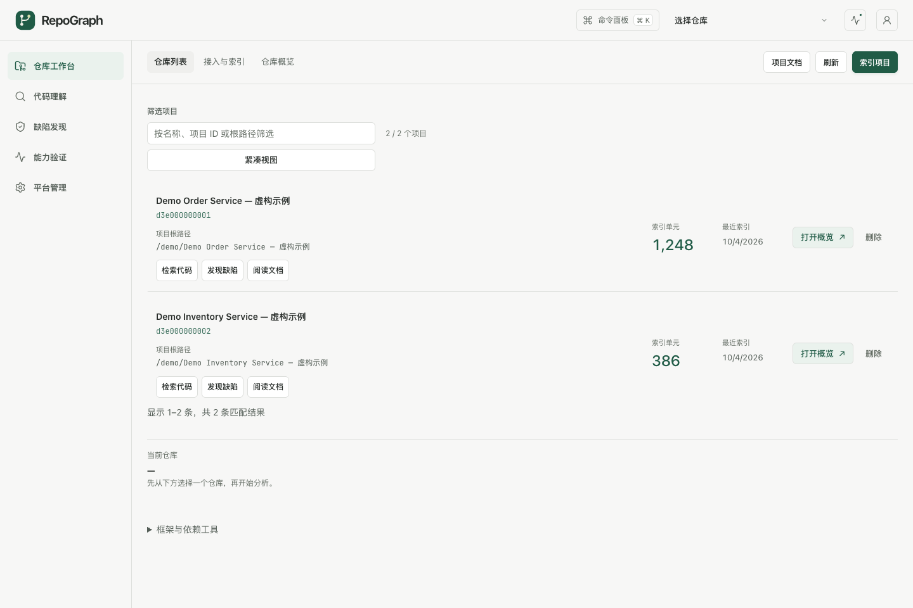
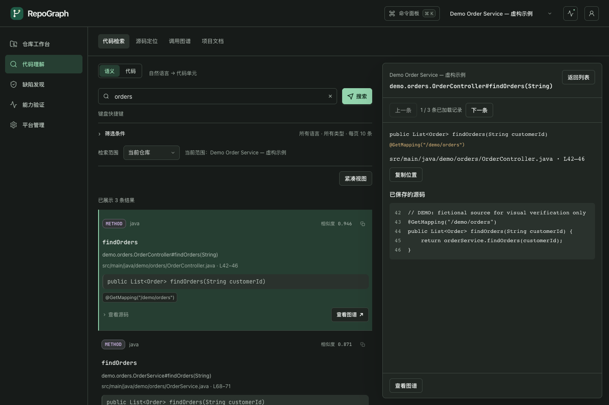

<p align="center">
  
</p>

# RepoGraph

**Turn a code repository into traceable context and evidence for security review.**

[中文](README.md) · [Quick start](#quick-start) · [Development](docs/DEVELOPMENT.md) · [Validation](docs/VALIDATION.md) · [MIT License](LICENSE)

RepoGraph brings source code, call relationships, retrieval, and scan results into one workspace. It helps engineering and security teams understand implementations, trace impact, and review security findings. Use the web console or REST API directly, or give coding agents access through the separate MCP server.

Indexing and storage can run locally or on your private network. Generation can use local Ollama, a cloud provider, or an enterprise gateway. When you enable a remote generation provider, relevant context is sent to that service. Retrieval embeddings and generation models have separate configurations.

## What you can do

| Workspace | Capabilities |
| --- | --- |
| Repositories | Import source and archives, build incremental indexes, view repository summaries, and enter tasks in repository context |
| Code understanding | Natural-language, code-similarity and keyword search; symbol lookup; call graphs and impact analysis; project Wiki |
| Defect discovery | Code, taint and dependency scans; external findings; agent-assisted triage; evidence reading and human review; quality metrics and SBOM |
| Capability checks | Inspect infrastructure, embedding, generation and offline retrieval evaluation as separate capabilities |
| Administration | Account approval, organization membership, project ownership, generation providers and audit records |

- **GraphRAG and Context Packs:** combine vectors, keywords and code relationships into citable context. Retrieval and context assembly do not require a generation model.
- **Evidence-based triage:** ingest Semgrep JSON, SARIF / CodeQL and other supported findings, then review them against code and call paths. Model suggestions do not automatically confirm vulnerabilities; human decisions retain separate audit records.
- **Multiple languages:** Java AST parsing; Tree-sitter with fallback for C, Python, JavaScript and TypeScript; heuristic C++ parsing; Markdown and optional Java bytecode parsing.
- **Everyday workflows:** current-repository scope, explicit search across authorized repositories, continuous source reading, a command palette, Chinese and English, system/light/dark themes, and mobile layouts.

## Interface

These screenshots use demo data in the isolated UI preview.

| Repository workspace | Search and source evidence |
| --- | --- |
|  |  |

## Quick start

### 1. Prepare the environment

- **JDK 25:** the Gradle toolchain targets Java 25. The app requires native access at runtime.
- **Docker and Docker Compose:** run Qdrant and Neo4j.
- **Ollama:** serves the default retrieval embedding model. Configure generation later through the administration page.

```bash
git clone https://github.com/Leo0426/repo-graph.git
cd repo-graph

# Start vector and graph storage
docker compose up -d
```

Start the Ollama service, then download the default embedding model:

```bash
ollama pull qwen3-embedding:latest
```

Default connections:

| Dependency | Address / configuration |
| --- | --- |
| Web / REST | `http://localhost:8080` |
| Qdrant | REST `16333`, gRPC `16334`; the app uses gRPC |
| Neo4j | Bolt `7687`, browser `7474`; local Compose credentials: `neo4j / neo4jneo4j` |
| Ollama embeddings | `http://localhost:11434`, `qwen3-embedding:latest`, 4096 dimensions |

See [application.yml](repograph-app/src/main/resources/application.yml) for addresses, models and collections. When changing the embedding model, check its dimensions and collection and build a matching index. Replace Compose example credentials and configure HTTPS before a shared or public deployment.

### 2. Build and start

```bash
./gradlew :repograph-app:bootJar :repograph-mcp:bootJar -x test

java --enable-native-access=ALL-UNNAMED \
  -jar repograph-app/build/libs/repograph-app-0.5.0.jar
```

`-x test` builds without running tests. The first build downloads Gradle and dependencies. After a version change, use the actual artifact name under `build/libs/`.

### 3. Sign in and index a repository

1. Open [http://localhost:8080](http://localhost:8080) and sign in as `admin`.
2. On the first start, if `REPOGRAPH_ADMIN_PASSWORD` is unset, a random initial password is written to `~/.repograph/bootstrap-admin-password`. With a custom database directory, the password file is alongside the database.
3. Under **Repositories → Import & index**, enter an **absolute repository path accessible to the app process**, start indexing, and wait for completion.
4. Open search, graphs, documentation or defect analysis from the repository row. Check failures and partial completion; an accepted request does not prove indexing succeeded.

New registrations require administrator approval. Regular users can access only projects assigned to them or their active organizations. Administrators assign projects under **Administration → Project ownership**.

### 4. Add a generation model when needed

Under **Administration → Model providers**, add a provider:

1. Choose a service template, or enter the protocol and Base URL for your gateway.
2. Enter an API key and click **Fetch models** to choose a model. Manual model IDs remain available when the service does not expose a model list.
3. Save, enable and select the provider for triage, project Wiki and architecture reviews.

Supported protocols are OpenAI Chat Completions, OpenAI-compatible APIs, Anthropic Messages and Ollama. Templates include OpenAI, Anthropic, Gemini's compatible endpoint, DeepSeek, Qwen, SiliconFlow, Ollama and a custom gateway. Model availability depends on the service and account.

Saving configuration and fetching model lists do not send generation requests. **Test connection** sends a short message and may incur a charge. Triage does not require token prices; unknown costs are not recorded as free. Saved API keys are not displayed; leaving the field blank while editing can retain the saved key. See the [development guide](docs/DEVELOPMENT.md#账号与-provider-本地配置) for credential changes and backups.

## Connect a coding agent with MCP

Start the app first and prepare an approved account with access to the required repositories. MCP runs as a separate stdio process and calls the app over HTTP, with the same permissions as that account in the web console.

Set `REPOGRAPH_USERNAME` and `REPOGRAPH_PASSWORD` in the MCP client's process environment, then add this server configuration:

```json
{
  "mcpServers": {
    "repograph": {
      "command": "java",
      "args": [
        "-jar",
        "/absolute/path/to/repo-graph/repograph-mcp/build/libs/repograph-mcp-0.5.0-exec.jar",
        "--base-url",
        "http://localhost:8080"
      ]
    }
  }
}
```

Replace the absolute JAR path. Keep passwords out of command-line arguments and committed configuration. MCP handles login, sessions and CSRF automatically. Its stdout is reserved for JSON-RPC; logs go to `~/.repograph/mcp.log`.

Common tools:

| Task | Examples |
| --- | --- |
| Find implementations and collect context | `search_semantic`, `search_code`, `search_keyword`, `search_graphrag`, `build_context_pack` |
| Trace relationships | `lookup_symbol`, `locate_at`, `find_callers`, `find_callees`, `get_impact` |
| Security analysis | `analyze_flow`, `trace_taint`, `triage_finding`, `record_triage_feedback` |
| Manage indexes | `list_projects`, `trigger_index`, `index_status` |

## Architecture and data

There are two Gradle subprojects. Names such as `core`, `graph` and `vector` refer to packages inside the app:

```text
repograph-app/   Spring Boot Web / REST
  core/         Domain models and interfaces
  parser/       Source, document and bytecode parsing
  graph/        Neo4j code relationships
  vector/       Qdrant vectors and Ollama embeddings
  retrieval/    GraphRAG, keywords and Context Packs
  finding/      External findings, triage and human review
  agent/        Workflows and step records
  modelprovider/ Generation configuration, encrypted credentials and protocols

repograph-mcp/   Separate MCP stdio server → HTTP → app
```

Neo4j stores code relationships, Qdrant stores retrieval vectors, and SQLite stores index caches, accounts, permissions, provider configuration and triage/review records. Runtime data defaults to `~/.repograph/`; container storage uses Compose volumes. Back up provider data together with the adjacent `provider-encryption-key` or the configured master key. Do not delete runtime data as if it were a build cache.

## Development and validation

```bash
# Regular Java tests, including embedded Neo4j
./gradlew test --tests '*Test'

# Same entry point as repository CI; inspect skipped tests in the reports
./gradlew check
```

Browser tests use an isolated preview with API fixtures and do not read the user's database. See the [UI test guide](repograph-app/src/test/ui/README.md) for setup and Playwright requirements. The [validation guide](docs/VALIDATION.md) covers real Qdrant integration, Semgrep executable checks and retrieval benchmarks. Skipped tests are not evidence of validation.

## Scope and limitations

RepoGraph provides static analysis and supporting evidence. It is not a full compiler and does not guarantee that every vulnerability will be found:

- Incomplete classpaths, missing dependency sources, reflection and generated code can leave call targets unresolved.
- Taint analysis, complexity metrics and data dependencies include conservative heuristics and require evidence review.
- Dependency scan coverage and freshness depend on the local Advisory data that has been imported.
- Remote models provide suggestions. Security conclusions and review actions still require human judgment.
- The app currently uses a single instance, SQLite and local sessions, without shared sessions across instances.

## Documentation

Most detailed guides are currently in Chinese.

- [Development](docs/DEVELOPMENT.md): installation, configuration, accounts, providers, MCP and troubleshooting.
- [Validation](docs/VALIDATION.md): test entry points, prerequisites and interpretation.
- [User manual](docs/user-manual.md): domain capabilities, REST API and MCP reference; use the development guide for current startup and authentication instructions.
- [Architecture](docs/ARCHITECTURE.md): package boundaries and main workflows.
- [Contributing](CONTRIBUTING.md): development conventions and contributions.

Released under the [MIT License](LICENSE).
