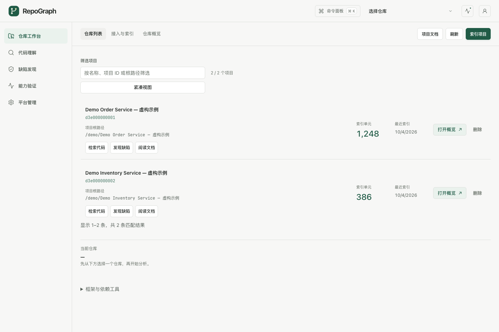
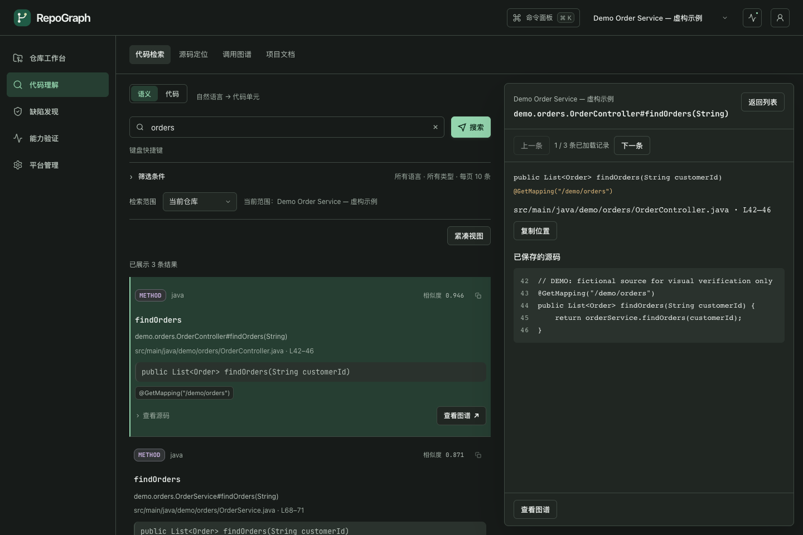

<p align="center">
  
</p>

# RepoGraph

**从代码仓库到可追溯的代码上下文与安全研判。**

[English](README.en.md) · [快速开始](#快速开始) · [开发指南](docs/DEVELOPMENT.md) · [验证指南](docs/VALIDATION.md) · [MIT License](LICENSE)

RepoGraph 将源码、调用关系、向量检索和扫描结果组织在同一个工作台中，帮助研发与安全团队理解代码、追踪影响范围、复核安全报警。Web 控制台与 REST API 提供交互入口，独立 MCP 服务把这些能力交给编码 Agent。

索引和存储可部署在本地或内网。生成模型可以使用本地 Ollama、云端服务或企业网关；启用远程生成服务时，相关上下文会发送到所配置的服务。检索用的 Embedding 与生成模型分别配置。

## 能做什么

| 工作域 | 主要能力 |
| --- | --- |
| 仓库工作台 | 接入源码与归档、增量索引、仓库概览，从同一仓库进入后续任务 |
| 代码理解 | 自然语言与代码相似检索、关键词检索、符号定位、调用图与影响面、项目 Wiki |
| 缺陷发现 | 内置代码/污点/依赖扫描、外部报警导入、Agent 研判、证据阅读与人工审核、质量指标与 SBOM |
| 能力验证 | 分别查看基础服务、Embedding、生成模型和离线检索评测的状态 |
| 平台管理 | 账号审批、组织成员、项目归属、生成模型 Provider 与管理审计 |

- **GraphRAG 与 Context Pack**：组合向量、关键词和代码关系，返回可引用的上下文；检索与组装本身无需生成模型。
- **基于证据的研判**：接入 Semgrep JSON、SARIF / CodeQL 等报警，结合代码与调用路径生成辅助意见。模型结论不会自动确认漏洞，人工审核保留独立记录。
- **多语言解析**：Java 使用 AST；C、Python、JavaScript、TypeScript 使用 Tree-sitter 并支持失败降级；另支持 C++ 启发式解析、Markdown 和可选 Java 字节码解析。
- **面向日常使用**：当前仓库默认范围、显式跨授权仓库检索、连续源码阅读、命令面板、中英文、系统/亮色/暗色主题与手机布局。

## 界面预览

以下截图使用隔离预览中的演示数据。

| 仓库工作台 | 代码检索与证据阅读 |
| --- | --- |
|  |  |

## 快速开始

### 1. 准备环境

- **JDK 25**：当前 Gradle toolchain 使用 Java 25；运行 app 时需要启用 native access。
- **Docker 与 Docker Compose**：用于启动 Qdrant 和 Neo4j。
- **Ollama**：提供默认的检索 Embedding；生成模型可稍后在管理页面配置。

```bash
git clone https://github.com/Leo0426/repo-graph.git
cd repo-graph

# 启动向量与图存储
docker compose up -d
```

启动 Ollama 服务后，下载默认 Embedding 模型：

```bash
ollama pull qwen3-embedding:latest
```

默认连接配置：

| 依赖 | 地址 / 配置 |
| --- | --- |
| Web / REST | `http://localhost:8080` |
| Qdrant | REST `16333`，gRPC `16334`；app 使用 gRPC |
| Neo4j | Bolt `7687`，浏览器 `7474`；本地 Compose 默认 `neo4j / neo4jneo4j` |
| Ollama Embedding | `http://localhost:11434`，`qwen3-embedding:latest`，4096 维 |

服务地址、模型与 collection 配置见 [application.yml](repograph-app/src/main/resources/application.yml)。更换 Embedding 模型时，需同步核对向量维度和 collection，重新建立匹配的索引。共享或对外部署前请更换 Compose 示例凭据，并配置 HTTPS。

### 2. 构建并启动

```bash
./gradlew :repograph-app:bootJar :repograph-mcp:bootJar -x test

java --enable-native-access=ALL-UNNAMED \
  -jar repograph-app/build/libs/repograph-app-0.5.0.jar
```

`-x test` 仅构建，不代表测试通过。首次构建需要下载 Gradle 和依赖；版本变化后，以 `build/libs/` 中的实际产物为准。

### 3. 登录并接入仓库

1. 打开 [http://localhost:8080](http://localhost:8080)，使用内置账号 `admin` 登录。
2. 首次启动未设置 `REPOGRAPH_ADMIN_PASSWORD` 时，随机初始密码保存在 `~/.repograph/bootstrap-admin-password`。使用自定义数据库目录时，密码文件位于数据库同目录。
3. 在“仓库工作台 → 接入与索引”填写 **app 进程可访问的仓库绝对路径**，提交索引并等待完成。
4. 从仓库行进入检索、图谱、文档或缺陷分析；查看失败与部分完成信息，不以请求已接受作为索引成功。

新用户注册后需要管理员审批。普通用户仅可访问分配给本人或所属有效组织的项目；管理员在“平台管理 → 项目归属”分配仓库。

### 4. 按需接入生成模型

在“平台管理 → 模型 Provider”中新增配置：

1. 选择服务模板，或填写企业网关的协议与 Base URL。
2. 填写 API key，点击“获取模型列表”并选择模型；服务不支持列表时可手填模型 ID。
3. 保存配置、启用并“设为当前”，供研判、项目 Wiki 和架构评审共用。

支持 OpenAI Chat Completions、OpenAI 兼容接口、Anthropic Messages 和 Ollama。模板包含 OpenAI、Anthropic、Gemini 兼容端点、DeepSeek、通义千问、硅基流动、Ollama 与自定义网关；具体可用模型以账号和服务为准。

保存配置和获取模型列表不会发送生成请求；“测试连接”会发送一条简短消息，可能产生费用。无需填写 token 单价即可研判，未知费用不会记为免费。API key 保存后不回显，编辑时留空可保留已有密钥；凭据备份和变更规则见[开发指南](docs/DEVELOPMENT.md#账号与-provider-本地配置)。

## 接入编码 Agent：MCP

先启动 app，并为 MCP 准备一个已批准、拥有所需仓库权限的账号。MCP 是独立的 stdio 进程，通过 HTTP 调用 app，权限与该账号在 Web 中一致。

在 MCP 客户端的进程环境中设置 `REPOGRAPH_USERNAME` 和 `REPOGRAPH_PASSWORD`，再添加服务配置：

```json
{
  "mcpServers": {
    "repograph": {
      "command": "java",
      "args": [
        "-jar",
        "/absolute/path/to/repo-graph/repograph-mcp/build/libs/repograph-mcp-0.5.0-exec.jar",
        "--base-url",
        "http://localhost:8080"
      ]
    }
  }
}
```

请替换 JAR 的绝对路径；密码不要放在命令行参数或提交到仓库的配置里。MCP 自动登录并维护会话与 CSRF，stdout 仅用于 JSON-RPC，日志写入 `~/.repograph/mcp.log`。

常用工具：

| 任务 | 工具示例 |
| --- | --- |
| 找实现与收集上下文 | `search_semantic`、`search_code`、`search_keyword`、`search_graphrag`、`build_context_pack` |
| 追踪代码关系 | `lookup_symbol`、`locate_at`、`find_callers`、`find_callees`、`get_impact` |
| 安全分析 | `analyze_flow`、`trace_taint`、`triage_finding`、`record_triage_feedback` |
| 管理索引 | `list_projects`、`trigger_index`、`index_status` |

## 架构与数据

只有两个 Gradle 子项目，`core`、`graph`、`vector` 等是 app 内部的包边界：

```text
repograph-app/   Spring Boot Web / REST
  core/         领域模型与接口
  parser/       源码、文档与字节码解析
  graph/        Neo4j 代码关系
  vector/       Qdrant 向量与 Ollama Embedding
  retrieval/    GraphRAG、关键词与 Context Pack
  finding/      外部报警、研判与人工审核
  agent/        工作流与步骤记录
  modelprovider/ 生成模型配置、加密凭据与协议适配

repograph-mcp/   独立 MCP stdio 服务 → HTTP → app
```

Neo4j 保存代码关系，Qdrant 保存检索向量，SQLite 保存索引缓存、账号权限、模型配置及研判/审核记录。默认运行数据位于 `~/.repograph/`，容器存储使用 Compose volume。备份模型配置时，需同时安全备份数据库旁的 `provider-encryption-key`，或所配置的主密钥；不要把运行目录当作构建缓存删除。

## 开发与验证

```bash
# 普通 Java 测试，含嵌入式 Neo4j
./gradlew test --tests '*Test'

# 与仓库 CI 相同的检查入口；核对报告中的 skipped 项
./gradlew check
```

浏览器回归使用隔离预览与模拟 API，不读取用户数据库。启动步骤及 Playwright 要求见 [UI 回归说明](repograph-app/src/test/ui/README.md)。真实 Qdrant 集成、Semgrep 实机验证和检索基准的环境要求与命令见[验证指南](docs/VALIDATION.md)；跳过不代表验证通过。

## 能力边界

RepoGraph 提供静态分析和辅助判断，不是完整编译器，也不保证发现全部漏洞：

- 缺少 classpath、外部源码、反射或生成代码时，调用目标可能无法完整解析。
- 污点、复杂度及数据依赖包含保守启发式，结果需要结合证据复核。
- 依赖扫描使用本地 Advisory 数据，覆盖范围和新鲜度取决于导入的数据。
- 远程模型只提供辅助意见；安全结论和审核动作仍需人工确认。
- 当前 app 以单实例、SQLite 与本地会话运行；不提供多实例会话共享。

## 文档

- [开发指南](docs/DEVELOPMENT.md)：安装、配置、账号、Provider、MCP 与排障。
- [验证指南](docs/VALIDATION.md)：测试入口、环境要求和结果解释。
- [用户手册](docs/user-manual.md)：领域能力、REST API 与 MCP 工具参考；启动和认证以开发指南为准。
- [架构说明](docs/ARCHITECTURE.md)：包边界与主要调用链。
- [贡献指南](CONTRIBUTING.md)：开发约定与提交方式。

项目采用 [MIT License](LICENSE)。
